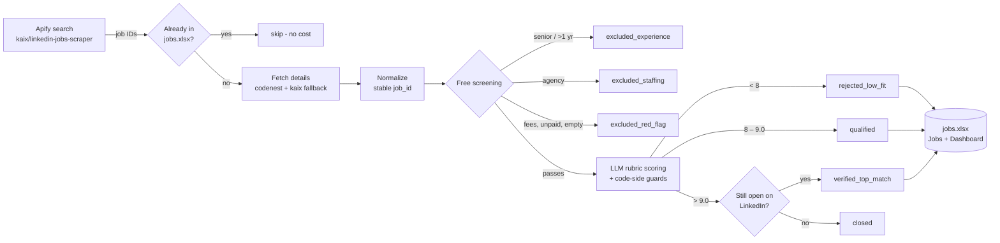

# Job Application Agent

**An AI-assisted job search agent that runs on your own machine.** It finds fresh LinkedIn postings, drops the ones you can't realistically get, scores the rest against your actual resume, and keeps only openings that are a very strong fit *and* still accepting applications. Results go into an Excel tracker with a live dashboard.

Honesty is enforced in code. The language model only *suggests* scores. Python checks every claim against your resume and applies the hard rules itself. Nothing is ever submitted on your behalf, and your data stays on your machine.

> **Current phase:** discovery, screening, scoring, verification and the Excel tracker.
> Resume tailoring is built and tested but **paused**; turn it on with `--tailor`.

---

## What it does

| | |
|---|---|
| 🔎 **Discovers** | Fresh jobs from **LinkedIn, Indeed and Naukri** using keyword searches (e.g. "Junior Data Engineer", India, last 24 h), through Apify |
| 🧹 **Screens** | Before any LLM call, drops roles needing more than 1 year of experience or tagged Mid-Senior, staffing-agency posts, and red flags (fees, unpaid work, empty descriptions) |
| 🎯 **Scores** | A 1–10 fit score from a rubric (skills, experience, projects, role). Every "matched skill" must be quoted verbatim from your resume, or it doesn't count |
| ✅ **Verifies** | Jobs scoring **> 9.0** are re-checked on LinkedIn every run, and only those still open become `verified_top_match` |
| 📊 **Tracks** | Everything lands in `jobs.xlsx` (one row per job, never duplicated). On every save it rebuilds a **Dashboard** plus **LinkedIn / Indeed / Naukri** tabs showing only openings scoring 8+ that were posted in the last 24 h |
| 📝 **Tailors** *(paused)* | A per-job resume that may only reorder and reword your own resume lines; a validator rejects any fabrication |

## How it works



### Why the scores can be trusted

The model is lenient on its own: in testing it gave 10/10 to a Mid-Senior role for a fresher. So **Python, not the model, decides the score.**

- `fit = 0.40·skills + 0.25·experience + 0.20·projects + 0.15·role`, clamped to 1–10.
- A matched skill counts only if its `resume_evidence` is a verbatim substring of the resume. Soft skills ("communication") never count. The skills score is capped at the share of technical requirements actually matched.
- **Strict experience rule:** the required years are the highest value among the model's reading, the posting's experience field, and the description text. More than 1 year, or LinkedIn seniority Mid-Senior or above, caps the score at 7.
- The 8/10 and 9.0 thresholds are constants in code. Contact details are stripped from the resume before it is sent to any model.

### Sources

| Source | Apify actor | Notes |
|---|---|---|
| LinkedIn | `kaix/linkedin-jobs-scraper` (search) + `codenest/linkedin-job-search-scraper` (details, with kaix fallback) | Live open-check for top matches |
| Indeed | `valig/indeed-jobs-scraper` (about $0.0001/job) | `country=in`, last 24 h, `expired` flag |
| Naukri | `valig/naukri-jobs-scraper` (about $0.0004/job) | last 24 h, experience filter, `consultant` flag marks agencies |

Job IDs are namespaced per source, so they never collide. Run a single source with `--sources indeed,naukri`.

### Detail fetching (LinkedIn)

- **Search:** `kaix/linkedin-jobs-scraper` in search-only mode, at about $0.00006 per hit.
- **Details:** `codenest/linkedin-job-search-scraper` is tried first. Any job it drops, or a crash of the whole actor, falls back to kaix's job-ID lookup (about $0.0003 per job).
- **Caps:** every actor call carries `maxItems` and `maxTotalChargeUsd`. A run stopped by its own spend cap keeps the results it already paid for.

## Quick start

**Requirements:**
- Python 3.10+
- An [Apify](https://apify.com) API token
- An [OpenRouter](https://openrouter.ai) API key. A little credit is enough, or see *Scoring without OpenRouter* below.
- Windows, macOS or Linux. The scheduled task is Windows-only.

**1. Install the dependencies:**

```bash
git clone https://github.com/MallikarjunaRaoPotti/job-application-agent.git
cd job-application-agent
pip install -r requirements.txt
```

**2. Add your keys** to `.env` in the repo root, using `KEY=value` lines (see `.env.example`):

```
APIFY_API_TOKEN=your-apify-token
OPENROUTER_API_KEY=your-openrouter-key
```

**3. Add your resume.** The data workspace lives at `<Desktop>/JobApplicationAgent/`. Set `JOB_AGENT_HOME` to put it elsewhere. Put your resume there as `resume.md`, following the layout of [`tests/fixtures/resume.md`](tests/fixtures/resume.md), which uses these sections:

- `# Name`
- a contact line
- `## Professional Summary`
- `## Technical Skills`, written as `- **Group:** a, b, c`
- `## Experience`
- `## Selected Projects`
- `## Education`
- `## Certifications & Achievement`

**4. Run a small, cheap first pass**, then a full run:

```bash
python scripts/run_pipeline.py --max-search-results 20 --max-detail-fetches 5   # costs a few cents
python scripts/run_pipeline.py                                                 # full daily run
```

Open `JobApplicationAgent/jobs.xlsx`. The **Dashboard** tab shows progress, and on the **Jobs** sheet you can filter `Processing Status = verified_top_match`.

> Close `jobs.xlsx` in Excel before a run, because Excel locks the file. The run stops with a clear message if it's open.

## Usage

```bash
python scripts/run_pipeline.py                         # discover -> screen -> score -> verify
python scripts/run_pipeline.py --skip-discovery        # only finish work already in jobs.xlsx
python scripts/run_pipeline.py --dry-run               # call the APIs, write nothing
python scripts/run_pipeline.py --reuse-search-dataset <APIFY_DATASET_ID>  # reuse a paid search
python scripts/run_pipeline.py --max-llm-usd 0.50      # OpenRouter spend cap for this run
python scripts/run_pipeline.py --tailor                # also generate resumes (paused by default)
```

### Configure the search

Edit `JobApplicationAgent/config/search.json`. The pipeline never overwrites it:

```json
{
  "queries": ["Junior Data Engineer", "Data Analyst fresher", "Generative AI Engineer", "..."],
  "locations": ["India"],
  "date_posted": "past_24h",
  "max_jobs_per_search": 50,
  "max_search_results": 1200,
  "max_detail_fetches": 440,
  "max_charge_usd_search": 0.20,
  "max_charge_usd_details": 2.65
}
```

### Run it every morning (Windows)

`scripts/run_daily.cmd` is a Task Scheduler launcher that appends output to `logs/scheduler.log`. To register it at 8 AM:

```powershell
$cmd = "$PWD\scripts\run_daily.cmd"
Register-ScheduledTask -TaskName "JobApplicationAgent Daily" `
  -Action (New-ScheduledTaskAction -Execute cmd.exe -Argument "/c `"`"$cmd`"`"") `
  -Trigger (New-ScheduledTaskTrigger -Daily -At 8:00AM) `
  -Settings (New-ScheduledTaskSettingsSet -StartWhenAvailable -MultipleInstances IgnoreNew)
```

`run_daily.cmd` finds Python on its own (set `PYTHON_EXE` to override) and runs `scripts/daily.py`, which logs to `logs/scheduler.log`. Check the launcher with `scripts
un_daily.cmd --check`. After the pipeline it runs the **Claude fallback** below, so jobs OpenRouter couldn't score still get scored.

### Scoring without OpenRouter

**Automatic.** `python scripts/agent_autoscore.py` scores whatever is still `unscored` by running headless [Claude Code](https://claude.ai/code) (`claude -p`) on batches of about 40 jobs:
- Claude writes the evaluations, and the import applies every code guard, the 9.0 bar and the open check.
- If nothing is waiting, it does nothing. The daily task runs it after every pipeline run, so when OpenRouter has no credit, Claude takes over.
- It finds Claude Code through `CLAUDE_BIN`, your `PATH`, or the VS Code extension.

**Manual**, inside an interactive Claude Code session:

```bash
python scripts/agent_scoring.py export                         # unscored jobs -> logs/agent_batch_N.json
# Claude reads the batch and writes logs/agent_eval_N.json (same schema as the scoring tool)
python scripts/agent_scoring.py import logs/agent_eval_N.json  # same code guards, 9.0 bar and open check
python scripts/agent_scoring.py import --rescore <file>        # replace earlier (e.g. inflated) scores
```

## Output

### `jobs.xlsx` → `Jobs` sheet

There is one row per job, keyed by a stable **Job ID**: `sha256` of the LinkedIn job ID, or of the canonical URL when there's no ID.

| Column | Contents |
|---|---|
| Job ID / Source Reference ID | Internal ID / LinkedIn's own job ID, exactly as given (never invented) |
| Job Title, Company, Location, Job Type, Work Mode, Salary, Job URL | From the posting |
| Job Description | The original description |
| Required / Preferred / Matched / Missing Skills | Missing skills are never added to a tailored resume |
| Match Score | Unrounded score computed in code, e.g. `9.60` |
| **Application Status** | **Yours to edit.** Set to "Not Applied" once and never overwritten |
| Date Discovered, Last Updated | When the job was first seen / when its row last changed |
| Resume Path, Tailoring Report Path | Filled only when tailoring runs |
| Processing Status | `verified_top_match`, `qualified`, `rejected_low_fit`, `excluded_experience`, `excluded_staffing`, `excluded_red_flag`, `closed`, `expired`, `unscored`, … |
| Error Details | The reason a job was excluded or failed, cleared on success |

Rows and any columns you add are preserved. Saves are atomic, and a `jobs.xlsx.bak` copy is kept.

### `LinkedIn`, `Indeed`, `Naukri` sheets

These are your daily shortlist: only openings with **Match Score ≥ 8.0 posted in the last 24 hours**, best first, with clickable links. Verified top matches are highlighted. They're rebuilt on every save, while the full history stays on the **Jobs** sheet for the agent's reference and deduplication.

### `Dashboard` sheet

The Dashboard is rebuilt automatically, so don't edit it. It shows:
- progress toward the goal (e.g. `6 / 200`) and KPI tiles;
- jobs by status;
- the match-score distribution;
- the verified top matches, with clickable links;
- why jobs were excluded;
- jobs discovered per day.

### Example: first full day

| Stage | Count |
|---|---|
| LinkedIn search hits | 1,053 |
| Senior titles skipped before paying for details | 360 |
| Jobs tracked | 544 |
| Excluded for experience / staffing / red flags | 273 / 22 / 9 |
| Scored | 226 |
| **Verified top matches (> 9.0, open)** | **6** |

Under a strict 0–1-year rule, about 1% of scraped jobs clear 9.0. Plan on daily runs.

## Costs

| | Per daily run |
|---|---|
| Apify search (about 1,200 hits) | ≤ $0.20 |
| Apify details (≤ 440 jobs, mostly via the kaix fallback) | ≈ $0.15 (capped at $2.65) |
| Open-status re-checks | < $0.02 |
| OpenRouter scoring (`nvidia/nemotron-3.5-lightning`, 8 in parallel) | ≈ $0.0005 per job, capped by `--max-llm-usd` (default $1) |

Jobs already in `jobs.xlsx` are never fetched or scored twice. When the LLM budget or credits run out, the remaining jobs wait as `unscored` and are never rejected.

## Resume tailoring (paused)

When enabled with `--tailor`:

1. The model returns a **plan**, not a resume. Every reworded bullet must cite the `source_id` of the resume line it rewrites, for example `PROJ2.b1`.
2. Code assembles the resume and copies your name, contact line, employers, dates, education and certifications verbatim.
3. [`validate_resume.py`](scripts/validate_resume.py) rejects the resume if it contains:
   - unknown tools (e.g. a job's "Azure");
   - numbers not in your resume;
   - any of the job's missing skills;
   - claims of "N years", "expert" or "senior";
   - changed dates, CGPA or project technologies.
4. A failing resume gets one corrective retry. After that it is never saved as final.
5. Results go to `output/resumes/<job_id>/resume.md`, with a `tailoring_report.md` showing every change before and after.

The same validator runs as a [Claude Code hook](.claude/hooks/resume_hook.py) for manual edits.

## Project structure

```text
scripts/
  run_pipeline.py     orchestrator: discover -> screen -> score -> verify -> (tailor) -> jobs.xlsx
  scrape_jobs.py      Apify search + detail fetch, normalization, stable IDs, dedup
  verify_jobs.py      free screening (experience, agencies, red flags) + LinkedIn open check
  score_jobs.py       rubric scoring via forced tool calling; all guards in code
  openrouter.py       thread-safe client: retries, call budget, spend cap, 402/429 handling
  agent_scoring.py    export/import for scoring by a Claude Code session
  excel_store.py      jobs.xlsx read/upsert/save (header-mapped, atomic, user columns preserved)
  dashboard.py        the Dashboard sheet (tables + native Excel charts)
  resume_parser.py    base resume -> ID-addressed units (SK1, EXP1.b1, PROJ2 ...)
  tailor_job.py       plan -> resume + tailoring report (paused)
  validate_resume.py  the fabrication gate (CLI + library)
  workspace.py        Desktop/JobApplicationAgent paths, resolved at runtime
  run_daily.cmd       Windows Task Scheduler launcher
tests/                pytest suite with fake Apify/LLM responses and a fictional sample resume
.claude/              Claude Code hook + tailor-resume skill
```

## Development

```bash
python -m pytest -q                         # 161 tests, temp workspace, no network, no cost
python -m pyflakes scripts tests .claude/hooks
```

Tests never touch your real Desktop: `JOB_AGENT_HOME` points at a temporary directory for every test. More detail on architecture and conventions is in [`CLAUDE.md`](CLAUDE.md), and the full spec is in [`PRD.md`](PRD.md).

## Limitations

- **LinkedIn data is thin.** Salary, work mode and stated years are often missing, so the experience rule falls back to the description text, which can miss unusual phrasing.
- **"Genuine" is heuristic.** Agency and red-flag rules catch the common cases, but templated "internship programs" can still slip through. Read every top match before applying.
- **LLM scores vary between runs.** The code-side guards narrow that, but a borderline job can land on either side of 9.0.
- **Scraping depends on third-party actors.** The primary detail actor has been unreliable, which is why the fallback exists.

## Responsible use

This tool prepares information for **you** to review. It never applies to jobs, never messages recruiters, and never invents qualifications. Respect LinkedIn's terms and keep your API spend caps sensible.
